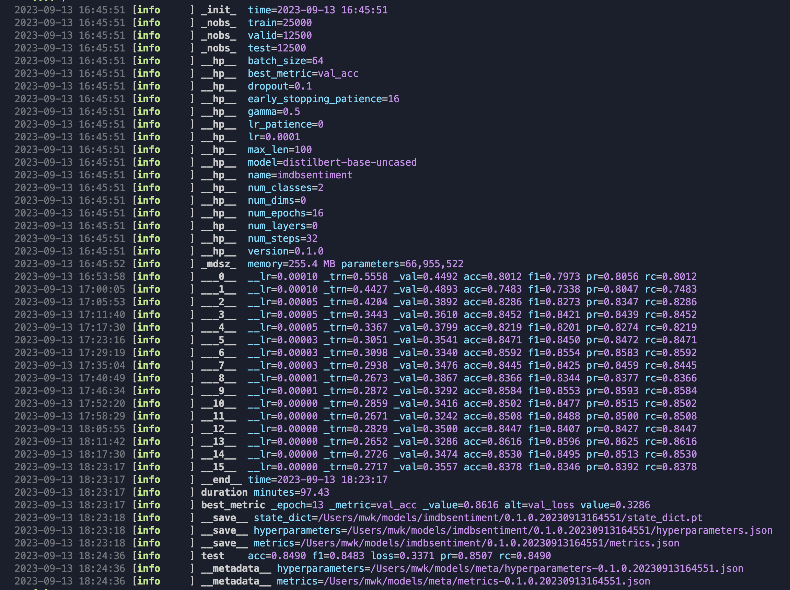

# Training pipelines

Training pipelines for `aimlabs` text classification models.

## Installation

From the repository root:

```bash
make develop        # or: uv sync --all-packages
```

## Data

`--input-dir` must contain `train`, `valid`, and `test` splits, each as a
`.parquet`, `.csv`, or `.jsonl` file with two columns:

| column  | type   | description                     |
|---------|--------|---------------------------------|
| `text`  | string | the message to classify         |
| `label` | string | the class label                 |

Labels are taken from the training split; `--num-classes` is corrected
automatically if it doesn't match.

## Usage

Fine-tune `distilbert-base-uncased` for sentiment classification on the IMDB
reviews dataset:

```bash
uv run python scripts/train.py \
    --input-dir ~/data/imdb \
    --output-dir models \
    --batch-size 16 \
    --best-metric val_loss \
    --dropout 0.15 \
    --early-stopping-patience 6 \
    --no-freeze \
    --lr 5e-5 \
    --max-len 512 \
    --model distilbert-base-uncased \
    --name imdbsentiment \
    --num-epochs 32 \
    --num-hidden 768 \
    --num-steps 128 \
    --test-max-steps -1 \
    --seed 42 \
    --save
```

Run `uv run python scripts/train.py --help` for every option; each
hyperparameter flag maps to a field of `aimlabs.HyperParameters`. The device
(CUDA → MPS → CPU) is detected automatically; override it with `--device`.

The best epoch (by `--best-metric`) is restored, evaluated on the test split,
and — with `--save` — written to `<output-dir>/<name>/<version>/`.

Logging output from the example above, replicating the IMDB benchmark (~93%
accuracy) for distilbert-base-uncased:



## Testing

```bash
make test
```
